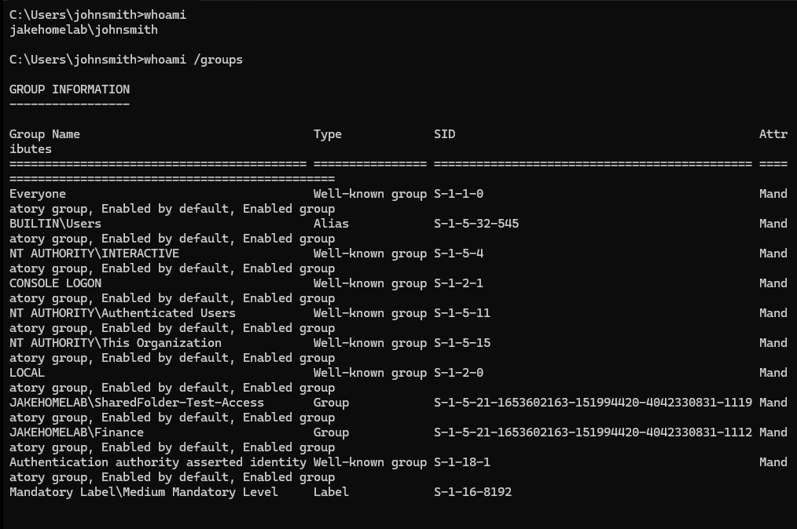

<h1>Ticket 006 — User Missing Application Access</h1>

<b>Issue</b>

A user was unable to access a restricted application folder on a shared network drive. The user received an Access Denied error when attempting to open the FinanceApp folder, despite being able to see it in File Explorer.

<b>Environment</b>

- Windows Server domain controller: JH-DC01

- Windows 11 domain-joined workstation: MAN-PC-001

- Active Directory domain: jakehomelab.test

- Network share: \\JH-DC01\SHARED

- Test folder: FinanceApp

- Test user: John Smith

- Security group: Finance

<b>Investigation</b>

<b>1. Reproduced the issue</b>

Attempted to open FinanceApp through the mapped SHARED (S:) network drive. Windows returned an Access Denied error, confirming that the user could see the folder but could not initially access its contents.

<b>2. Checked Active Directory security groups</b>

Opened Active Directory Users and Computers on the domain controller and located the Finance security group. Confirmed that the Finance security group still existed.

<b>3. Reviewed folder permissions</b>

Opened the advanced security settings for C:\SHARED\FinanceApp on the server. Confirmed that the Finance security group had been granted Read & execute permissions for the folder, its subfolders and files.

<b>4. Tested access and collected diagnostic evidence</b>

Used Command Prompt to verify the signed-in account and inspect its security groups:

- whoami — confirmed the signed-in account was jakehomelab\johnsmith.

- whoami /groups — checked the security groups included in the current logon token.

The Finance security group was not listed.

- dir \\JH-DC01\SHARED\FinanceApp — tested whether the user could list the directory contents.

The initial directory listing failed, confirming the access problem.

<b>Root Cause</b>

John Smith’s account required the appropriate Finance group membership and permissions to access the restricted folder. The issue was resolved by ensuring the user was a member of the Finance security group and that the group had the necessary folder permissions.

<b>Resolution</b>

- Added John Smith to the Finance security group in Active Directory.

- Confirmed that the Finance group had Read & execute permissions on the FinanceApp folder.

- Signed out and back into the Windows 11 workstation to refresh the user’s logon token.

- Re-tested access to the shared folder.

<b>Verification</b>

- whoami confirmed the correct domain account.

- whoami /groups showed JAKEHOMELAB\Finance in the refreshed logon token.

- The dir command successfully listed Application-Access-Test.txt in the FinanceApp directory.

- Opened the test file successfully, confirming that access had been restored.

<b>Skills Demonstrated</b>

- Active Directory user and security group administration

- NTFS folder permissions and access control

- Windows network shares and UNC paths

- Command-line troubleshooting

- User logon token and group membership verification

- Least-privilege access management

- Testing and documenting a resolution
